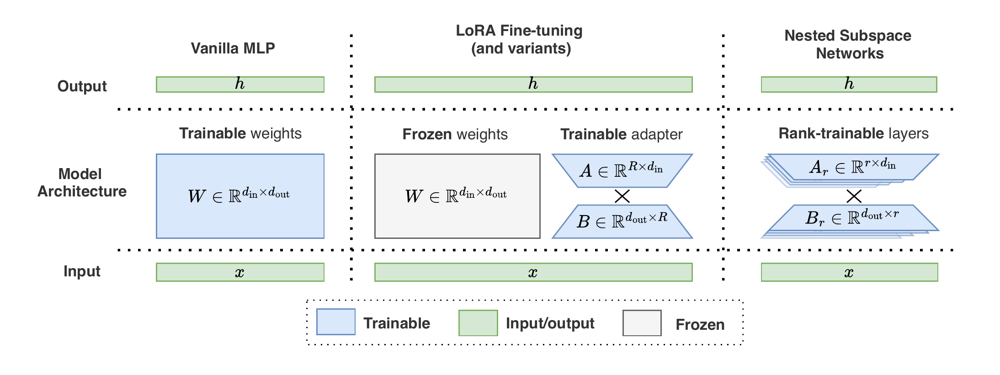
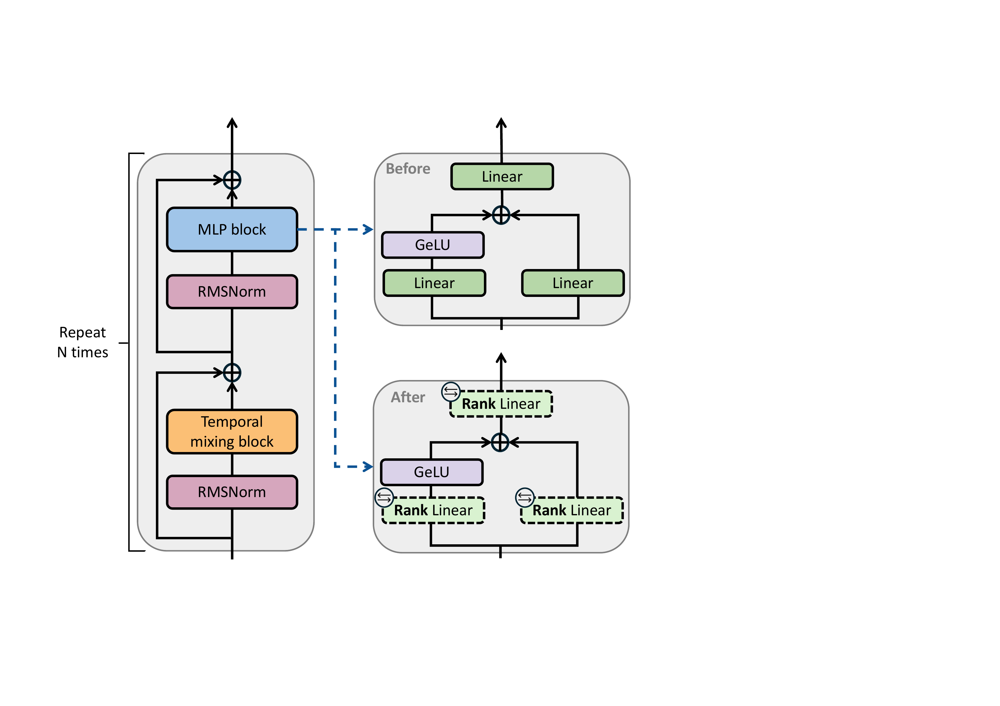

# Nested Subspace Networks (NSNs)

**Deep Hierarchical Learning with Nested Subspace Networks for Large Language Models**

[Paulius Rauba](https://scholar.google.com/citations?user=NoVFmOgAAAAJ&hl=en&oi=ao) and [Mihaela van der Schaar](https://www.vanderschaar-lab.com/) — University of Cambridge

**ICLR 2026** &ensp;|&ensp; [Paper (arXiv)](https://arxiv.org/abs/2509.17874) &ensp;|&ensp; [OpenReview](https://openreview.net/forum?id=ymUOPsbxLi)

---

<p align="center">
  
</p>

> **TL;DR** &mdash; We introduce *Nested Subspace Networks*, a way to build a single neural network that can instantly adjust its performance vs. computational cost at inference time. A single NSN-adapted LLM achieves a **50% reduction in inference FLOPs** with only a **5 percentage-point drop** in accuracy.

Large neural networks are typically trained for a fixed computational budget, creating a rigid trade-off between performance and efficiency.
NSNs re-parameterize each linear layer as a product $W_r = B_r A_r$ where $A_r$ and $B_r$ are prefixes of shared factor matrices $(A, B)$.
Because the rank-$r$ subspace is always contained in the rank-$(r{+}1)$ subspace, a single set of weights encodes a **continuous hierarchy of models** that can be traversed at inference time by simply changing the active rank &mdash; no retraining, no model zoo.

The hierarchy is trained jointly via an **uncertainty-aware objective** that automatically balances the difficulty of different ranks, and a **curriculum sampling** strategy that introduces lower ranks progressively.

## How NSNs are applied to pre-trained LLMs

<p align="center">
  
</p>

Each MLP block in a transformer contains standard `nn.Linear` layers (**Before**).
NSNs surgically replace these with **rank-adaptive** linear layers (**After**), initialized via SVD decomposition $W \approx BA$.
At inference time, setting a lower rank uses fewer rows/columns of $(A, B)$, directly reducing FLOPs while keeping the rest of the architecture untouched.

## Repository structure

```
.
├── src/lowrank/                   # Core library (installable as `lowrank`)
│   ├── models/
│   │   ├── layers.py              # DynamicLowRankLinear — the core NSN layer
│   │   ├── mlp.py                 # LightMLP (baseline) and DynamicMLP (NSN MLP)
│   │   ├── llm.py                 # Gemma sequence-classification with NSN layers
│   │   ├── lowrank_llms.py        # Low-rank LLM wrapper
│   │   └── lowrank_mlp_ce.py      # MLP with full loss-variant ablations
│   ├── callbacks.py               # RankEvalCallback for multi-rank validation
│   ├── trainer.py                 # LowRankTrainer (Hugging Face Trainer subclass)
│   ├── flops.py                   # FLOPs analysis utilities
│   └── data/                      # Data modules (MNIST, CIFAR-10, CIFAR-10 embeddings)
│
├── experiments/                   # One script per paper experiment
│   ├── exp_01.py                  # Native-rank training vs. rank truncation
│   ├── exp_02.py                  # Native-rank vs. nested (curriculum) training
│   ├── exp_03.py                  # Ablation study of training objectives
│   ├── exp_04.py                  # Learned log-variance dynamics
│   ├── exp_05.py                  # End-to-end LLM pipeline (4 models on MNLI)
│   ├── train.py                   # General-purpose PyTorch Lightning entrypoint
│   ├── eval.py / eval_llms.py / eval_ranks.py   # Evaluation scripts
│   ├── extract_cifar10_features.py               # ResNet-18 feature extraction
│   └── convert_to_lowrank.py     # Convert a pre-trained model to NSN form
│
├── scripts/                       # Shell wrappers for full reproducibility
│   ├── exp_01.sh … exp_05.sh
│   └── run_evals.sh
│
├── notebooks/
│   ├── 00_FLOPs.ipynb             # FLOPs analysis across models and ranks
│   └── 01_Figures.ipynb           # Paper figure generation
│
├── pyproject.toml                 # Project dependencies
└── uv.lock                        # Reproducible dependency lock
```

## Setup

**Requirements:** Python >= 3.13, CUDA-capable GPU, [uv](https://docs.astral.sh/uv/)

```bash
git clone https://github.com/pauliusrauba/nested-subspace-networks.git
cd nested-subspace-networks

# Install all dependencies (creates .venv automatically)
uv sync

# Include Jupyter for notebooks
uv sync --group dev
```

## Quick start

### Core layer

`DynamicLowRankLinear` factorizes a linear layer as $W = BA$ and lets you change the active rank at any time:

```python
import torch
from lowrank.models.layers import DynamicLowRankLinear

layer = DynamicLowRankLinear(in_features=512, out_features=256, max_rank=64)
x = torch.randn(1, 512)

layer.set_rank(64)
out_full = layer(x)   # uses all 64 components

layer.set_rank(32)
out_half = layer(x)   # uses the first 32 — a strict subspace of the above
```

### Applying NSNs to a pre-trained LLM

`decompose_and_replace` swaps every `nn.Linear` inside the MLP blocks with `DynamicLowRankLinear`, initializing factors via truncated SVD of the original weights:

```python
from lowrank.models.layers import decompose_and_replace
from transformers import AutoModelForSequenceClassification

model = AutoModelForSequenceClassification.from_pretrained(
    "google/gemma-2b", num_labels=3,
)

# Replace MLP layers with NSN layers (SVD-initialized)
decompose_and_replace(model, max_rank=1024, target_substring="mlp")

# At inference time, set the rank to trade off compute vs. accuracy
for m in model.modules():
    if hasattr(m, "set_rank"):
        m.set_rank(512)  # 50% of max rank -> ~50% MLP FLOPs savings
```

### Training a nested MLP from scratch

```python
import pytorch_lightning as pl
from lowrank.models.mlp import DynamicMLP
from lowrank.data.cifar_emb import CIFAR10EmbeddingDataModule
from lowrank.callbacks import RankEvalCallback

model = DynamicMLP(
    input_size=512,
    num_classes=10,
    rank=64,
    teacher_mode="max",
    loss_variant="ce_with_consistency",
)

dm = CIFAR10EmbeddingDataModule(feat_dir="data/cifar10_emb", batch_size=128)

trainer = pl.Trainer(
    max_epochs=30,
    accelerator="gpu",
    callbacks=[RankEvalCallback(ranks=[64, 32, 16, 8, 4, 2, 1], ood_ranks=[3, 5, 10])],
)
trainer.fit(model, dm)
```

After training, evaluate the **same** model at any rank:

```python
for r in [64, 32, 16, 8, 4, 2, 1]:
    model._set_rank_all(r)
    trainer.test(model, dm)
```

## Reproducing the paper experiments

Each experiment has a self-contained Python script in `experiments/` and a wrapper shell script in `scripts/` that handles data preparation and execution.

### Experiments 1 &ndash; 4: CIFAR-10 embeddings (single GPU)

```bash
# Step 0 — extract CIFAR-10 ResNet-18 embeddings
# (runs automatically inside the scripts below, or manually:)
uv run python experiments/extract_cifar10_features.py --root data/cifar10_emb

# Exp 1: native-rank training vs. rank truncation
bash scripts/exp_01.sh

# Exp 2: native-rank vs. nested (curriculum) training
bash scripts/exp_02.sh

# Exp 3: ablation study of training objectives
bash scripts/exp_03.sh

# Exp 4: learned log-variance dynamics
bash scripts/exp_04.sh
```

Results are written to `results/exp_XX/` as CSV files.

### Experiment 5: LLM pipeline (multi-GPU)

Trains and evaluates NSN-adapted Pythia-2.8B, GPT-Neo-2.7B, Qwen2-0.5B, and Gemma-2B on MNLI:

```bash
# Full pipeline (2 GPUs)
bash scripts/exp_05.sh

# Generate the figure from pre-computed results only
uv run python experiments/exp_05.py --results_dir results/exp_05/ --plot_only
```

### Paper figures

```bash
uv run jupyter lab notebooks/
```

Open `01_Figures.ipynb` to regenerate all figures from the result CSVs.

## Method

### Nested subspace architecture

Each `nn.Linear(d_in, d_out)` is replaced by a pair of factor matrices $A \in \mathbb{R}^{R \times d_\text{in}}$ and $B \in \mathbb{R}^{d_\text{out} \times R}$.
At rank $r$, the effective weight is $W_r = B_r A_r$ where $A_r$ consists of the first $r$ rows of $A$ and $B_r$ consists of the first $r$ columns of $B$.
Since rank-$r$ uses a prefix of the same factors as rank-$(r{+}1)$, the image spaces are nested:

$$\text{Im}(W_1) \subseteq \text{Im}(W_2) \subseteq \cdots \subseteq \text{Im}(W_R)$$

This means every lower-rank model is a strict sub-model of every higher-rank model &mdash; all within one set of weights.

### Uncertainty-aware training objective

Two ranks are sampled per training step &mdash; an **anchor** $\tilde{R}$ (high rank) and a **variant** $r$ (low rank).
Their cross-entropy losses are combined via learned log-variance parameters $s_k = \log \sigma_k^2$:

$$\mathcal{L}\_\text{total} = \bigl(\exp(-s\_{\tilde{R}}) \cdot \mathcal{L}\_\text{CE}(\tilde{R}) + s\_{\tilde{R}}\bigr) + \bigl(\exp(-s\_r) \cdot \mathcal{L}\_\text{CE}(r) + s\_r\bigr)$$

The model automatically learns to **up-weight easy ranks** (low variance) and **attenuate hard ranks** (high variance), achieving stable gradient balancing without per-rank hyperparameter tuning.

### Curriculum rank sampling

Variant ranks are introduced progressively: during the first epoch only the highest variant ranks are sampled; lower ranks are unlocked gradually.
From the second epoch onward all ranks are sampled uniformly.
This stabilizes early training and yields better final performance at all ranks, including interpolated (out-of-distribution) ranks not seen during training.

## Citation

```bibtex
@inproceedings{
  rauba2026deep,
  title={Deep Hierarchical Learning with Nested Subspace Networks},
  author={Paulius Rauba and Mihaela van der Schaar},
  booktitle={The Fourteenth International Conference on Learning Representations},
  year={2026},
  url={https://openreview.net/forum?id=ymUOPsbxLi}
}
```

## License

This project is released under the [CC BY 4.0](https://creativecommons.org/licenses/by/4.0/) license.
